 

| Languages | Backend & Frameworks | AI | ML / Data | Databases & Infra | Tools |
|:---:|:---:|:---:|:---:|:---:|:---:|
|  |  |  |  |  |  |
|  |  |  |  |  |  |
|  |  |  |  |  |  |
|  |  |  |  | | |
| | |  | | | |

